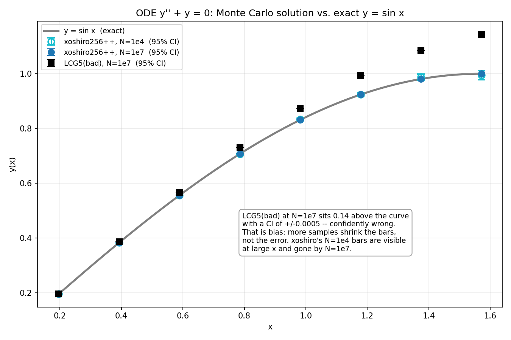
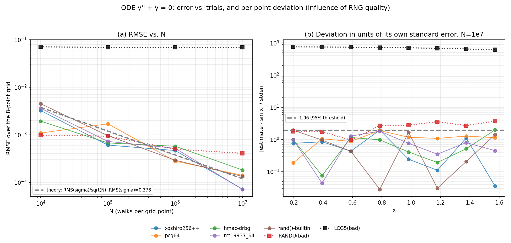

# Solving y″ + y = 0 by Monte Carlo

**Spec task 10.2.** Deliverable for OPEN_RESEARCH item #7.
Tool: `rng_ode` (`tools/ode_monte_carlo.cpp`, estimator in `tools/ode_solver.hpp`).
Raw results: `docs/ode_results.csv`.
Design spec: `docs/design/2026-08-24-ode-monte-carlo-design.md`.

---

## 1. What this measures, and why it is not a statistical battery

The batteries (NIST SP 800-22, Dieharder, TestU01, PractRand — item #3) ask
whether a byte stream *looks* random. This asks a different question:

> When the stream is consumed by a real numerical method, does the answer come
> out right, and does the error obey the law theory predicts?

The value is that we know the exact answer. `y″ + y = 0` with `y(0)=0`,
`y′(0)=1` has the solution `y = sin x`, so every deviation is measurable
rather than inferred. Three things follow that the batteries cannot give:

* **It measures the RNG through a consumer.** A defect invisible in raw bytes
  but amplified by arithmetic — division, comparison, weighted accumulation —
  would surface here or nowhere.
* **It tests a specific law, not an absence of pattern.** Not "looks random"
  but "error shrinks as `O(1/√N)`, with the constant the run's own variance
  predicts."
* **It quantifies detection.** §7 below states, in samples, how large a defect
  this task can resolve — which turns out to be the most useful result here.

### 1.1 Choice of formulation

The spec's methodological note is explicit that this is a **Cauchy (initial
value) problem**, and that random walks and Feynman–Kac are natural for
*boundary-value* elliptic problems rather than an oscillatory IVP. It offers
two adaptations; we took the recommended one.

| Option | Taken? | Reason |
|---|---|---|
| **Volterra integral equation + von Neumann–Ulam** | ✅ | Spec's recommendation; exactly unbiased; RNG quality has direct, visible impact |
| Boundary-value reformulation, walk-on-spheres/grid | ❌ | `y″ = −y` is **Helmholtz**, not Laplace. The zeroth-order term forces a path weight that *grows* rather than decays, so variance behaves far worse and the clean theory stops being clean |
| Feynman–Kac | ❌ | Spec lists it as an optional advanced variant; same Helmholtz issue plus more machinery |

---

## 2. Derivation

### 2.1 Volterra form

Integrate `y″ = −y` once, using `y′(0) = 1`:

```
y′(x) = 1 − ∫₀ˣ y(s) ds
```

Integrate again, using `y(0) = 0`, and collapse the double integral with
Dirichlet's formula (`∫₀ˣ∫₀ˢ y(u) du ds = ∫₀ˣ (x−u) y(u) du`):

```
y(x) = x − ∫₀ˣ (x − t) y(t) dt                                          (1)
```

Write `y = f + Ky` with `f(x) = x` and `(Kg)(x) = −∫₀ˣ (x−t) g(t) dt`.

### 2.2 The Neumann series is the Taylor series of sin

**Claim.** `Kⁿf(x) = (−1)ⁿ x^(2n+1)/(2n+1)!`

*Proof by induction.* Base: `K⁰f = f = x`. Step: assume the claim for `n`.
Since `∫₀ˣ (x−t) t^(2n+1) dt = x^(2n+3)/[(2n+2)(2n+3)]`,

```
K^(n+1)f(x) = −∫₀ˣ (x−t) · (−1)ⁿ t^(2n+1)/(2n+1)! dt
            = (−1)^(n+1) x^(2n+3) / [(2n+1)! (2n+2)(2n+3)]
            = (−1)^(n+1) x^(2(n+1)+1) / (2(n+1)+1)!                      ∎
```

Therefore

```
y = Σ_{n≥0} Kⁿf = x − x³/3! + x⁵/5! − ⋯ = sin x
```

The Neumann series and the Taylor series are the same object reached from two
directions. This identity is what the deterministic tests check against, and
it is why a derivation error cannot hide behind a plausible-looking number.

### 2.3 Importance sampling: why the weight is constant

Sampling `t` uniformly on `(0,x)` gives the per-step weight `−(x−t)·x/q`,
which varies with `t` and can exceed 1. Instead draw from

```
p(t | x) = 2(x − t) / x²        on (0, x)                                (2)
```

which is normalised (`∫₀ˣ 2(x−t)/x² dt = 1`). The kernel's `(x−t)` factor now
cancels against the density exactly:

```
−(x−t) g(t) / p(t|x) = −(x²/2) · g(t)
```

so the weight collapses to the **constant**

```
W(x) = −x²/2                                                             (3)
```

independent of `t`. Sampling stays closed-form. Inverting
`F(t) = (2xt − t²)/x²`:

```
t = x (1 − √(1−u)),        u ~ U(0,1)                                    (4)
```

Substituting `t = x(1−s)` with `s = √(1−u)` verifies the round trip exactly:
`F(t) = (1−s)(1+s) = 1 − s² = u`. Because `t < x` always, the walk moves
monotonically toward the origin and weights shrink as it goes.

> **Implementation note.** `SampleT` evaluates (4) in the algebraically
> equivalent conjugate form `t = x·u / (1 + √(1−u))`. The direct form cancels
> catastrophically as `u → 0` and returns exactly 0 for `u ≲ 2⁻⁵²`, silently
> collapsing the walk to the origin.

### 2.4 Russian roulette, and exact unbiasedness

With survival probability `q ∈ (0,1)`, define the score `S(x)`:

```
draw B ~ Bernoulli(q)
if B = 0:  return f(x)
if B = 1:  draw t ~ p(·|x);  return f(x) + (W(x)/q) · S(t)
```

**Claim.** `E[S(x)] = y(x)`.

```
E[S(x)] = f(x) + q · (1/q) · E_t[ W(x) · y(t) ]
        = f(x) + ∫₀ˣ [2(x−t)/x²] · (−x²/2) · y(t) dt
        = f(x) − ∫₀ˣ (x−t) y(t) dt
        = f(x) + (Ky)(x)
        = y(x)                                                       ∎ (5)
```

**The estimator is exactly unbiased — not approximately.** This is the single
load-bearing design decision. Fixed-depth truncation was rejected precisely
because it would introduce a bias of our own making; when a defective RNG then
produced a wrong answer, the error could not be attributed. With (5), *every*
observed deviation from `sin x` is variance or RNG defect. Nothing else.

Note also there is **no discretisation error**. Unlike Euler or Runge–Kutta
there is no step size `h` and no `O(hᵏ)` truncation term: each `x` is
evaluated independently and exactly in expectation.

### 2.5 Variance is finite, and grows with x

The second moment `M(x) = E[S(x)²]` satisfies its own Volterra equation:

```
M(x) = x² + 2x·(Ky)(x) + (x²/2q) ∫₀ˣ (x−t) M(t) dt                       (6)
```

Volterra equations with continuous kernels on a finite interval have
convergent Neumann series for *any* kernel magnitude — the iterated kernels
carry factorial decay — so `M(x) < ∞` for every `x` and every `q ∈ (0,1)`.
Finite is not small, though: the `x²/2q` factor means variance climbs with
`x`, which §6.3 measures directly.

No numeric variance figure is asserted here. `σ̂` is **measured** at run time
and reported alongside every estimate.

---

## 3. Acceptance criteria

There is deliberately **no fixed error threshold**. A bound like
"error < 10⁻³" would be arbitrary — it depends on `N`, on `x`, and on a
variance we do not know in advance. Since §2.4 establishes bias is exactly
zero, the correct criterion is *statistical consistency*.

**The headline statistic is**

```
ratio = RMSE·√N / RMS(σ̂)
```

comparing the error actually observed against the error the run's own measured
variance predicts. Its expectation is **1** for any sound engine at any `N`,
independent of engine and sample size — which is what makes it readable at a
glance.

`RMSE·√N` alone is a much weaker criterion than it appears. Across the grid the
per-point `σ̂` values span a factor of ~450, so the effective degrees of
freedom of the RMSE is

```
(Σσ²)² / Σσ⁴ ≈ 2.4
```

giving `RMSE·√N` a relative scatter around ±45%. It cannot resolve a
3× error floor on its own. Dividing by `RMS(σ̂)` — the value it is *predicted*
to equal — removes that, and empirically `RMS(σ̂) ≈ 0.378` for every sound
engine at every `N` in our runs.

Criteria, in order of weight:

1. **Coverage.** Across all grid cells, `|est − sin x| < 1.96·σ̂/√N` should
   hold ~95% of the time. Over the 160 sound-engine grid cells this is the
   highest-power statistic available.
2. **Ratio.** Should sit near 1 and, crucially, should **not climb with N**.
3. **RMSE and max error** — spec-mandated, reported, but read in light of the
   scatter above.
4. **Layer-1 exactness** — the deterministic tests of §5 must pass.

---

## 4. Experiment

| Axis | Values |
|---|---|
| Engines (ours) | `xoshiro256++`, `pcg64`, `hmac-drbg` |
| Engines (spec 10.3 comparators) | `mt19937_64` (Mersenne Twister), `rand()-builtin` (C library) |
| Broken controls | `RANDU(bad)`, `LCG5(bad)` |
| `N` | 10⁴, 10⁵, 10⁶, 10⁷ |
| `x` grid | 8 points on `(0, π/2]` (`kπ/16`, `k=1..8`) |
| Stress point | `x = π`, reported separately |
| `q` | 0.5 (CLI-tunable) |

`x = π` is excluded from the RMSE deliberately: `W(x) = −x²/2` makes it a
different variance regime, and averaging the two together would hide both.
The CSV carries a `regime` column so this separation survives aggregation.

Each `(engine, N)` cell is seeded freshly, so the `N=10⁴` row is not a prefix
of the `N=10⁷` row — otherwise the convergence trend would be an artefact of
nesting.

**Three of the seven engines are single-orbit**, and for them a fresh seed
buys *separation*, not independence: distinct seeds are distinct offsets on
one shared cycle.

* `RANDU` (period 2²⁹) and `LCG5` (2³¹) are the deliberate controls; at
  `N=10⁷` RANDU consumes a large fraction of its cycle. Acceptable for
  controls whose purpose is to fail, and stated so the failure is not
  mistaken for something it is not.
* **`rand()-builtin` (period 2³¹) is not a deliberate control, and this
  bites.** At the R=25 stability run's `N=10⁷` row it consumes ~1.75× its
  entire period, so its repeats wrap rather than merely overlap. See §8.5 —
  it is excluded from the stability conclusions for this reason.

The SDK's own engines are not affected at any scale used here:
`xoshiro256++`'s period is `2²⁵⁶ − 1`, `pcg64`'s is `2¹²⁸`, and the DRBGs
reseed by construction.

---

## 5. Test strategy

Two layers, so that a failure is *attributable*.

| Test | Layer | What it pins |
|---|---|---|
| `TestOdeNeumannSeries` | 1 (no RNG) | `Kⁿf` closed form; partial sums → `sin` |
| `TestOdeSampler` | 1 | `SampleT` inverts its own CDF |
| `TestOdeExpectationMatchesSeries` | 1 | **`E[walk]` equals the analytic partial sums** |
| `TestOdeForcedWalkTermMatchesNeumannTerm` | 1 | `ForcedWalkTerm`'s expectation equals an isolated `Kᵈf(x)` — underpins the depth diagnostic (§7.1) |
| `TestOdeWalkScripted` | 1 | walk arithmetic incl. the weight **product** |
| `TestOdeWelfordMatchesTwoPass` | 1 | `σ̂` against a naive two-pass variance |
| `TestOdeConvergence` | 2 (statistical) | sample mean converges to `sin x` |

`TestOdeExpectationMatchesSeries` is the one that makes the attribution claim
honest. It evaluates `E[S(x)]` deterministically by Gauss–Legendre quadrature
**through the same `SampleT` and `WalkWeight` the random walk calls**, and
asserts it reproduces `NeumannPartialSum`. Without it, every Layer-1 test
checked a *parallel* implementation of the mathematics that shares no code
with the estimator, so a mismatched sampler/weight pair would have passed them
all. (The roulette probability cancels in that identity — `q·W/q = W` — which
is itself a check that the `1/q` compensation is right.)

**These tests were validated by mutation testing, not by inspection.** Four
deliberate defects were injected; each was caught by at least one test, and
each test caught something no other did:

| Mutation | expectation test | scripted walk | Welford |
|---|---|---|---|
| `weight *=` → `weight =` (destroys the product) | pass | **fail** | pass |
| Welford `d*(s−mean)` → `d*d` | pass | pass | **fail** |
| `WalkWeight` drops the `/2` | **fail** | **fail** | pass |
| roulette `1/q` compensation removed | pass | **fail** | pass |

Before this sweep, the scripted-walk test exercised only 0- and 1-survival
walks, so `weight *=` and `weight =` were indistinguishable to it.

---

## 6. Results

> Regenerate with `rng_ode 7 --csv docs/ode_results.csv`. Method parameters
> for every table below: `q = 0.50`, 8 grid points on (0, pi/2], N = 1e4 to
> 1e7. No machine or compiler is recorded because these numbers are
> seed-deterministic and reproduce anywhere, unlike the throughput figures
> (OPEN_RESEARCH #7c(a)).

### 6.1 Convergence on (0, π/2]

`ratio = RMSE·√N / RMS(σ̂)`; expectation 1. `RMS(σ̂) ≈ 0.378` for every sound
engine at every `N`, which is what makes the column comparable across rows.

| Engine | N=10⁴ | N=10⁵ | N=10⁶ | N=10⁷ | coverage (of 32) |
|---|---|---|---|---|---|
| `xoshiro256++` | 0.86 | 0.51 | 1.24 | 0.61 | 32/32 |
| `pcg64` | 0.29 | 1.43 | 0.74 | 1.18 | 29/32 |
| `hmac-drbg` | 0.51 | 0.56 | 1.52 | 1.52 | 31/32 |
| `mt19937_64` | 0.95 | 0.61 | 1.38 | 0.60 | 32/32 |
| `rand()-builtin` | 1.20 | 0.80 | 0.78 | 1.12 | 30/32 |
| **`RANDU(bad)`** | 0.26 | 0.78 | **1.32** | **3.41** | 27/32 |
| **`LCG5(bad)`** | **20.69** | **63.14** | **200.60** | **636.78** | **0/32** |

**Aggregate 95% CI coverage, sound engines: 154/160 = 96.2%** (theory: 95%,
over 5 engines × 4 N × 8 grid points = 160 cells, not fully independent since
cells within one engine/N row share a walk-count budget but are drawn from
independent grid points). That is five independent engines agreeing with the
nominal rate, which is the strongest single piece of evidence that the
estimator is unbiased and `σ̂` is honestly calibrated.

Reading the two controls:

* **`LCG5`** — `RMSE` is flat at ~6.9 × 10⁻² across three decades of `N`
  (7.084e-2 → 6.943e-2 while `N` grows 1000×). The error is a floor, not
  noise; `ratio` grows by very close to `√10` per decade (measured 3.05,
  3.18, 3.17 against `√10 ≈ 3.162`), the signature of a constant error
  against a shrinking CI. Coverage 0/32 throughout.
* **`RANDU`** — `ratio` climbs monotonically 0.26 → 0.78 → 1.32 → **3.41**
  and coverage collapses to **3/8** at `N=10⁷`. Its `RMSE` falls only 2.4×
  while `N` grows 1000× (a sound engine falls ~31.6×). The floor is ~4 × 10⁻⁴.

RMSE at `N=10⁷` for the sound engines runs 7.1 × 10⁻⁵ (`mt19937_64`) to
1.8 × 10⁻⁴ (`hmac-drbg`); max error over the grid runs 1.4 × 10⁻⁴
(`mt19937_64`) to 5.0 × 10⁻⁴ (`hmac-drbg`) — absolute errors of order 10⁻⁴
across the grid, from a purely stochastic method with no discretisation.

### 6.2 Spec 10.3 comparison

The spec asks for accuracy, speed and stability against Mersenne Twister,
PCG64, xoshiro256++ and the language built-in.

**Accuracy:** all five sound engines are statistically indistinguishable on
this task — every `ratio` sits in [0.29, 1.52] with no trend in `N`, and
coverage is at nominal. **No engine's Monte Carlo accuracy is limited by its
randomness quality here; all are limited by `1/√N`.** This is the expected and
correct result: a well-constructed non-cryptographic generator and a NIST DRBG
should produce identical accuracy, and they do.

The lowest single `ratio` among the sound engines is `pcg64`'s 0.29 at
`N=10⁴`, and it is not evidence of superiority: with ~2.4 effective degrees of
freedom a value that low is well within scatter, and the same engine posts the
highest reading in the next column (1.43 at `N=10⁵`). Reading any ordering
into this column is over-reading it.

**Stability is measured separately, and the `ratio` column is not a
substitute.** Spec 10.3 means spread of the answer across independent repeats;
every cell in `ode_results.csv` is a **single run** at one seed, and `stddev`
is the within-run deviation of the walk scores, not run-to-run
reproducibility. The absence of a trend in `ratio` across `N` is weak
circumstantial evidence for stability, not a measurement of it.

That measurement now exists: `rng_ode --repeats R` re-estimates the same
quantity at R distinct seeds and reports the run-to-run `sd` against the
theoretical prediction, closing #7c(c), together with the fitted convergence
exponent #7c(d). Results are in §6.6 below and
`docs/ode_stability.{txt,csv}`.

**Speed** is not measured here either — `rng_bench` owns throughput, and mixing
a timing axis into an accuracy experiment would confound both. As of
2026-08-25 that cross-reference is complete: `rng_bench` measures C `rand()`
through this same `RandBuiltin` adapter, so all five of spec 10.3's generators
have a throughput figure and the speed and accuracy columns describe the same
generators (#7c(b)).

Two caveats attach to any number taken from it. `RandBuiltin` spends five
`rand()` calls per 64-bit word, so its row is the cost of a word as this task
consumes it, not of one `rand()` call. And the committed
`docs/benchmark_results.txt` is **not yet a complete answer to spec §6** — not
because the laptop is unreliable (idle run-to-run spread is 1.05–1.38× per
row; the much larger spread recorded earlier was measured under concurrent
build load and does not characterise the machine), but because §6 asks for
results across CPU architectures and this is one x86-64 box. The second
architecture is delegated to the partner's machine alongside the batteries
(#7c(a)). As of 2026-08-27 that file's tables are medians produced one binary
at a time by `tools/bench_median.py`, so figures may be taken from them
directly; earlier revisions carried single contended runs that could not.
What the cross-reference does support, because it is an order-of-magnitude
claim rather than a ratio, is the two-tier pitch: `hmac-drbg` is ~2 orders of
magnitude slower per word than `xoshiro256++` (DESIGN_NOTES §8) while
delivering the same accuracy.

### 6.3 Variance growth at x = π

`σ̂` on the grid is ~0.378; at `x = π` the sound-engine values run
8.41 (`hmac-drbg`, N=10⁴) to 11.35 (`pcg64`, N=10⁶), settling to ~10.5–10.9
by N=10⁷ — a factor of ~28 to 29 over the grid value (10.7/0.3786 ≈ 28.3).
This is (6) behaving as predicted — `W(x) = −x²/2` grows with `x` — and it is
reported rather than hidden. Consequence: at `N=10⁷` the `x=π` estimates carry
absolute errors around 10⁻³ rather than 10⁻⁴. The method degrades away from
the origin, which is a genuine limitation of this estimator, not an RNG result.

### 6.4 Serial-correlation diagnostic

Lag-1 and lag-2 autocorrelation of the walk-score sequence, `N=10⁶`, `x=π/4`
(under i.i.d., each is asymptotically `N(0, 1/N)`):

| Engine | lag-1 | lag-2 |
|---|---|---|
| `xoshiro256++` | −0.00053 (−0.5 se) | +0.00032 (0.3 se) |
| `RANDU(bad)` | +0.00079 (0.8 se) | +0.00004 (0.0 se) |
| `LCG5(bad)` | +0.00019 (0.2 se) | −0.00027 (−0.3 se) |

All within noise. See §7.1 — this rules out one candidate explanation and is
reported as a negative result.

### 6.5 Plots (spec 10.2)

Generated by `tools/plot_monte_carlo.py` from `docs/ode_results.csv` — a pure
post-processing script that runs no RNG itself, so the figures cannot drift
from the committed numbers.

**Numerical vs. analytical solution.**



Deliberately **not** all seven engines. At `N = 10⁷` the five sound engines
agree with `sin x` to within `1.4–5.0 × 10⁻⁴` over the grid, and even `RANDU`
is within `9.5 × 10⁻⁴`, so overlaying six curves that coincide at plot
resolution yields a figure carrying one bit of information. Instead this
shows one engine at two sample sizes with
its own 95% CIs, plus one broken control — which makes the distinction the
whole document turns on visible directly:

* `xoshiro256++` at `N = 10⁴` has error bars reaching `±0.016` at large `x`;
  by `N = 10⁷` they have shrunk below marker size and the points sit on the
  curve. **Error and uncertainty shrink together** — the signature of a
  sound engine on an unbiased estimator.
* `LCG5(bad)` at `N = 10⁷` sits `0.14` above the curve with a CI of
  `±0.0005` — off by ~300 times its own error bar. **Confidently wrong.**
  Its uncertainty shrank while its error did not, which is what an error
  floor *is*. Note also that the gap widens with `x`, consistent with
  `W(x) = −x²/2` amplifying the pair-skew bias of §7.1.

Per-engine comparison is the error figure's job, below.

**Error graph** (spec-mandated, kept as its own figure):



*Panel (a), RMSE vs `N`* — this is the spec-mandated error-vs-trials graph.
The grey reference is not a fitted slope but the theoretical prediction
`RMS(σ̂)/√N` with `RMS(σ̂) = 0.378` measured from the run itself (§3). Sound
engines scatter around it across three decades. `LCG5` is flat at `~7×10⁻²` —
an error floor, not shrinking noise. `RANDU` tracks the prediction until
`N = 10⁶` and then flattens at `~4×10⁻⁴`, the same "invisible until enough
samples resolve it" pattern §6.1's `ratio` column shows, visible here directly
in the RMSE trend rather than only in the normalised statistic — the
sensitivity threshold of §7 made visible.

*Panel (b), deviation per grid point at `N = 10⁷`, in units of that point's
own standard error* (`|estimate − sin x| / stderr`). Normalising by each
point's own `σ̂/√N` is what lets all seven engines share one axis despite
variance growing ~450× across the grid. The `1.96` line is the 95%
threshold, so a sound engine should cross it about 5% of the time:

| Engine | points above 1.96 (of 8) |
|---|---|
| `xoshiro256++`, `pcg64`, `mt19937_64`, `rand()-builtin` | 0 |
| `hmac-drbg` | 1 |
| **`RANDU(bad)`** | **5** |
| **`LCG5(bad)`** | **8** (at `z = 615–757`) |

This is the §6.1 coverage column drawn rather than tabulated, and the two
agree exactly — §6.1 records RANDU's coverage collapsing to 3/8 at `N=10⁷`,
i.e. 5/8 outside, and `hmac-drbg` missing exactly one cell overall.

### 6.6 Stability and fitted convergence exponent (spec 10.3, 10.1)

`rng_ode --repeats R` re-estimates the **same** quantity at R distinct seeds,
which is what spec 10.3's "stability" means and what §6.1's single-run cells
cannot show. Committed at **R = 25**, `q = 0.5`, at two grid points —
`x = π/4` (mid-domain) and `x = π/2` (highest variance in the domain).
Artifacts: `docs/ode_stability.{txt,csv}`, `docs/ode_convergence_fit.csv`.

The reported `sd` is the run-to-run spread of the 25 estimates; `predicted_sd`
is the estimator's own `σ̂/√N` averaged over those runs, so `sd_ratio ≈ 1`
tests whether `σ̂` is honestly calibrated — the same question §6.1's coverage
column answers, measured directly rather than inferred.

**Stability.** Over the 40 sound-engine cells, `sd_ratio ∈ [0.75, 1.55]` at
`x = π/4` and `[0.69, 1.12]` at `x = π/2`. At R = 25 the nominal 95% band for
`s/σ` is `[0.72, 1.28]`, and 3 of 40 cells sit outside it — close to the ~2
expected. That nominal band is a **lower** bound on the true spread here: it
assumes normally-distributed estimates, whereas the walk score is heavy-tailed
(the weight accumulates factors of `−x²/q`, which grow at `x = π/2`). **No
engine is separable from another on stability**, and the report must not rank
them on this axis.

**Convergence exponent.** All five sound engines cover the theoretical −0.50
at both grid points:

| Engine | slope at `x=π/4` [95% CI] | slope at `x=π/2` [95% CI] |
|---|---|---|
| `xoshiro256++` | −0.486 [−0.752, −0.219] | −0.490 [−0.664, −0.317] |
| `pcg64` | −0.481 [−0.580, −0.382] | −0.474 [−0.519, −0.430] |
| `hmac-drbg` | −0.528 [−0.638, −0.417] | −0.494 [−0.558, −0.429] |
| `mt19937_64` | −0.476 [−0.670, −0.281] | −0.506 [−0.556, −0.455] |
| `rand()-builtin` | −0.495 [−0.547, −0.444] | −0.499 [−0.563, −0.435] |
| **`RANDU(bad)`** | −0.372 [−0.543, −0.202] | −0.320 [−0.633, −0.006] |
| **`LCG5(bad)`** | **+0.001 [−0.003, +0.005]** | **+0.001 [−0.004, +0.005]** |

`LCG5` is the unambiguous failure: a slope of **+0.001 with a CI of width
0.008** — its error does not shrink *at all* across three decades, and its
bias is constant to three digits (`+2.22 × 10⁻²` at `π/4`, `+1.44 × 10⁻¹` at
`π/2`). This is what "converged to the wrong answer" looks like as a number.

**RANDU is the honest hard case, and this task does not convict it on the
slope.** Its point estimates (−0.372, −0.320) sit well above −0.50, but both
CIs *cover* −0.50 — df = 2 is simply too wide to exclude it. The floor is
nonetheless visible in the **bias** column, which stops shrinking while `sd`
keeps falling:

| `x=π/2` | N=10⁴ | N=10⁵ | N=10⁶ | N=10⁷ |
|---|---|---|---|---|
| `RANDU` bias | −1.12e-3 | −8.46e-4 | −7.53e-4 | −9.10e-4 |
| `RANDU` sd | 7.86e-3 | 2.61e-3 | 6.70e-4 | 1.98e-4 |
| ratio | 0.14 | 0.32 | 1.12 | **4.6** |

So the sharper detector for RANDU on this task remains §6.1's `ratio` and
coverage columns (3.41 and 3/8 at `N=10⁷`), not the fitted exponent. Across
the whole study RANDU's slope CI excludes −0.50 in exactly one place: **π-3D**
(−0.335, [−0.477, −0.194]), which is the three-dimensional test for a
three-dimensional defect. That is the correct and complete statement.

> **This paragraph is a correction, and the reason the audit was worth
> running.** An earlier version of this run seeded both grid points
> identically (`RepeatSeed(base, r, e)`, no `x` term) while the walk's
> roulette test is also `x`-independent — so the two points consumed a
> bit-identical uniform stream and were one measurement scored twice
> (`bias/predicted_sd` correlated at **1.00**). Under that bug the `x = π/2`
> block appeared to **exclude** −0.50 for RANDU, which read as independent
> corroboration of the π-3D finding. With genuinely independent streams
> (`GridSlotBase`) it does not. The corroboration was an artefact of the
> shared stream. See OPEN_RESEARCH (f).

**`rand()-builtin` is excluded from the `N = 10⁷` stability conclusions**: its
25 repeats consume ~1.75× its entire 2³¹ period and therefore wrap rather than
merely overlap (§4, §8.5). Its slopes above are reported for completeness and
are not evidence about run-to-run independence at that row.

---

## 7. What this task can and cannot detect

**This is the main result, and it is a correction of an earlier claim.**

An initial reading of the N ≤ 10⁵ rows concluded that RANDU *passes* this task,
and a second control (`LCG5`) was added on the premise that without it the
spec's correlation study would go undemonstrated. **That conclusion was
wrong,** and it was caught in code review rather than by the author.

RANDU fails. Its `ratio` climbs monotonically with `N` and its coverage
collapses at `N = 10⁷`. What the small-`N` rows showed was not the absence of
an error floor but a floor *not yet resolved* — which is precisely the mistake
this task exists to teach a reader not to make. The design spec had
pre-registered this risk (§7) and pre-committed to reporting whatever was
measured; the first write-up kept the prediction instead of the measurement.
The episode is recorded here rather than quietly corrected because the failure
mode — reading data to confirm a hypothesis one has already written down — is
exactly what the pre-registration existed to prevent.

The corrected finding is stronger than the one it replaces. Both controls
fail, at sample sizes three orders of magnitude apart:

| Control | Error floor | First unambiguous at |
|---|---|---|
| `LCG5(bad)` | ~7 × 10⁻² | `N = 10⁴` |
| `RANDU(bad)` | ~4 × 10⁻⁴ | `N ≈ 10⁶–10⁷` |

So the claim this task supports is a **sensitivity threshold**, not a binary
verdict:

> An error floor of size `ε` becomes visible once `N` is large enough that the
> statistical error `σ/√N` falls below `ε`.

With `σ ≈ 0.378`, resolving a floor of `4 × 10⁻⁴` needs `N ≳ 10⁶`, which is
exactly where RANDU's failure appears. The arithmetic is consistent with the
observation.

**Consequence for the SDK.** A Monte Carlo task that a generator passes at
small `N` says very little, because the floor may simply not have emerged
yet. This is a quantitative statement of why the external batteries — which
test structure directly rather than through a smooth functional — remain
mandatory, and it is a better argument for them than any assertion.

### 7.1 The mechanism, localized by depth

Two candidate mechanisms were tried and discarded before the one that holds.

**Rejected: pairs vs. triples via the roulette parameter.** An early
explanation proposed that the walk consumes uniforms in pairs and so sees
RANDU's 2-D lattice while missing its 3-D plane structure. This was retracted
after informal testing across the roulette parameter `q` failed to show a
clean pattern — but that measurement was never committed as a reproducible
artefact, so it should be read as "inconclusive and unreproduced," not as
having established anything either way.

**Ruled out (within its resolving power): walk-to-walk correlation.** If
consecutive *walks* were correlated, the i.i.d. assumption behind `σ̂` would
break and coverage would collapse with no per-walk bias at all. The
`rng_ode` serial-correlation diagnostic measures lag-1 and lag-2
autocorrelation of the walk-score sequence at `N = 10⁶`; RANDU's values sit
within 1 standard error of zero. This detects only *short-lag* correlation —
at the observed `ratio ≈ 3.4` the implied `Σ ρ_k` is small enough to hide
across many lags — so the finding is "no short-lag correlation detected,"
not a general exclusion.

**Confirmed: bias concentrated at depth 3, matching the triple relation
`randu_bad.hpp` already documents.** `DepthDecomposition` isolates each
Neumann term `Kᵈf(x)` in complete isolation, via `d` forced hops with no
roulette (`ForcedWalkTerm`, proved correct in `TestOdeForcedWalkTermMatchesNeumannTerm`
against the same quadrature used for the partial-sum test). Each hop consumes
exactly one uniform, so `d = 3` is the first depth spanning three
**consecutive** draws — the exact width of RANDU's defining relation
`x_{n+2} = 6x_{n+1} − 9x_n (mod 2³¹)`. At `N = 2 × 10⁷`, `x = π/2`:

| Engine | `d=1` (1 draw) | `d=2` (pair) | `d=3` (triple) |
|---|---|---|---|
| `xoshiro256++` | z = −0.75 | z = −0.22 | z = −1.23 |
| `RANDU(bad)` | z = **+0.01** | z = −2.03 | z = **−9.69** |
| `LCG5(bad)` | z = +1.60 | z = **+446.0** | z = −445.8 |

RANDU is clean at `d=1`, only mildly off at `d=2`, and breaks decisively at
`d=3` — consistent with a defect that is genuinely three-dimensional and
essentially invisible in lower dimensions, exactly as its well-known 2-D
projections (which are fine) versus 3-D projections (which are not) would
predict. `d=2` and `d=3` share sign and are not independent (they overlap by
construction — `d=3`'s first two draws are `d=2`'s pair), so the modest
`d=2` value is plausibly an echo of the same triple structure rather than a
separate effect.

`LCG5` shows the opposite pattern — massive, opposite-signed bias at `d=2`
and `d=3` alike, consistent with its established mechanism
(`TestSmallMultiplierLcgPairSkew`): conditioned on the walk surviving its
roulette draw (`u₁ < q`), the next uniform is `u₂ = frac(5u₁ + 2⁻³¹)`, which
for `q = 0.5` places 60% of its mass below 0.5 instead of 50%. That bias
propagates into everything downstream of the first pair, which is why both
`d=2` and `d=3` break together rather than `d=3` alone.

Reproduce with `rng_ode 4` (the depth diagnostic runs regardless of the
requested `N` sweep and takes a fixed, independent sample size).

---

## 8. Limitations

1. **Variance grows with `x`.** `W(x) = −x²/2`, so the `x = π` stress rows
   carry `σ̂` roughly 28× the grid values (§6.3). Reported, not hidden.
2. **RMSE over 8 grid points is a low-df statistic** (≈2.4 effective df).
   This is why `ratio` and coverage carry the verdict; see §3.
3. **`q` is not swept in the committed run.** It is CLI-exposed, and a
   weight-window heuristic (`q` matched to `|W(x)|`) is a plausible variance
   reduction, but neither is built. YAGNI.
4. **The control seeds share one orbit** (§4). Adequate for controls; would
   not be adequate for an engine under evaluation.
5. **`rand()-builtin` exhausts its period in the R=25 stability run, and this
   is a finding rather than only a caveat.** MSVC's `rand()` has an output
   period of `2³¹ ≈ 2.15 × 10⁹`, and `RandBuiltin` spends five `rand()` calls
   per 64-bit word. At `N = 10⁷` the 25 repeats therefore consume `≈ 3.75 ×
   10⁹` draws — **1.75× the entire period**. Those repeats do not merely
   correlate, they *wrap*: the generator is physically incapable of supplying
   25 independent runs at that scale. The `sd` reported for `rand()-builtin`
   in §6.6's `N = 10⁷` row is consequently not a run-to-run spread over
   independent streams, and is excluded from the stability conclusions on the
   same grounds as `RANDU` and `LCG5` (§4's single-orbit caveat, which now
   names all three). Stated positively, this is direct evidence for spec
   10.3: *the language built-in cannot support a study of this size at all*,
   which none of the SDK's own engines come close to (`xoshiro256++`'s period
   is `2²⁵⁶ − 1`).
6. **`rand()-builtin` uses process-global state.** `std::srand`/`std::rand`
   are not per-instance, so this comparator is valid only because `rng_ode`
   runs engines strictly sequentially. It must not be reused under item #9's
   multithreading. It also assumes non-degenerate low output bits, true on
   MSVC and glibc but not guaranteed by the standard for every libc — see
   `tools/std_engine_adapters.hpp`.
7. **`OdeWalkScore` and `ForcedWalkTerm` are capped at `kMaxWalkDepth`
   (200,000).** Exists because a defective `u01()` can otherwise hang
   forever rather than terminate with bias — exactly what happened with the
   original `rand()`-builtin adapter (§7 in `OPEN_RESEARCH.md`). A capped
   walk throws rather than silently truncating.

---

## 9. Reproduction

```
cmake --build build --config Release --target rng_ode

# §6.1-6.5 -- single-run tables, diagnostics and plots (~4 min)
build/Release/rng_ode 7 --csv docs/ode_results.csv
python tools/plot_monte_carlo.py

# §6.6 -- stability and fitted exponent, R=25 repeats (~57 min)
build/Release/rng_ode 7 --repeats 25 \
    --stability-csv docs/ode_stability.csv \
    --fit-csv docs/ode_convergence_fit.csv
```

The plot script also regenerates the pi plots from `docs/pi_results.csv` in
the same run — one script covers spec 10.1 and 10.2 together (§6.5).

`--repeats` runs a *different* experiment and replaces the single-run tables
rather than adding to them, so passing `--csv` alongside it is rejected rather
than silently ignored. Arguments are otherwise validated the same way: a
mis-typed exponent or `--q` is rejected rather than silently reinterpreted,
`max_exponent` is capped at 8, and `--repeats` at 10,000 (the bound that keeps
the per-grid-point seed bases provably disjoint — see `GridSlotBase`).

All CSVs are written at 17 significant digits, which round-trips a double
exactly: every derived column (`abs_err`, `bias`, …) is re-derivable from the
file itself. Verified — the bias/variance identity `rms_err² = bias² +
sd²(R−1)/R` reproduces over the committed stability files to 1.8e-16.

The estimator is header-only (`tools/ode_solver.hpp`) and deliberately outside
`include/rngsdk/` — it is a validation instrument for this report, not shipped
SDK surface, the same rationale as `randu_bad.hpp`.
